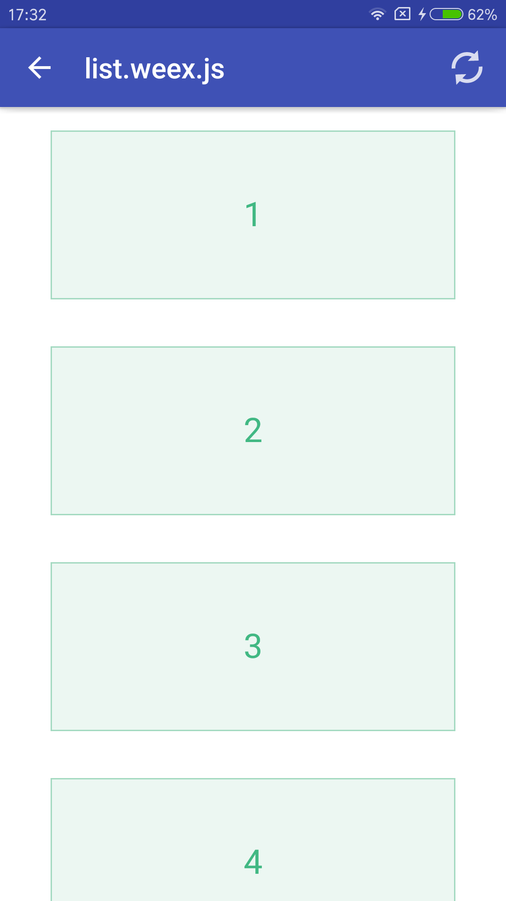

## Weex-Quick-Start
[](https://github.com/zhoukekestar/weex-quick-start)
[](http://makeapullrequest.com)

Este proyecto es un punto de inicio rápido para Weex. Si tienes mejores ejemplos o deseas mejorar la explicación del código para que sea más detallada y clara, ¡no dudes en enviar un PR! Haré mi mejor esfuerzo por fusionarlo. ^-^. Te recomiendo visitar la [página de descargas](https://github.com/zhoukekestar/weex-quick-start/releases) para descargar la última versión del APK y probarla en tu teléfono. Si no funciona, podría deberse a problemas de compatibilidad con tu dispositivo. Si funciona correctamente, ¡puedes utilizarlo con total confianza!

## Configuración del Entorno
* IDE: Android Studio 2.2.1
* Sistema: Windows 10, 64 bits.
* Gradle: 2.14.1
*[Registro de comandos](https://github.com/zhoukekestar/weex-quick-start/blob/master/cmds.md)
```bash
git clone https://github.com/zhoukekestar/weex-quick-start
cd weex-quick-start
gradle build  
// Como no he configurado la ruta del comando gradle, el comando real es "C:\Program Files\Android\Android Studio\gradle\gradle-2.14.1\bin\gradle" build
// El APK generado se encuentra en el directorio app\build\outputs\apk
// También puedes abrir la carpeta directamente con Android Studio para compilar
```

## Desarrollo de Weex
* `cd weex` para entrar en el directorio de desarrollo de Weex
* `npm run build` compila los archivos de Weex en los directorios dist y assets de Android
* `serve` inicia el servidor (requiere instalar el comando `serve`: `npm install serve -g`)
* Abre un navegador y visita `http://localhost:3000/public/`

## Capturas de Pantalla
| Página principal | Después el clic |
| --- | --- |
|  |  |

## Detalles de la Compilación de Android
*[Detalles](https://github.com/zhoukekestar/weex-quick-start/blob/master/HISTORY.md)
